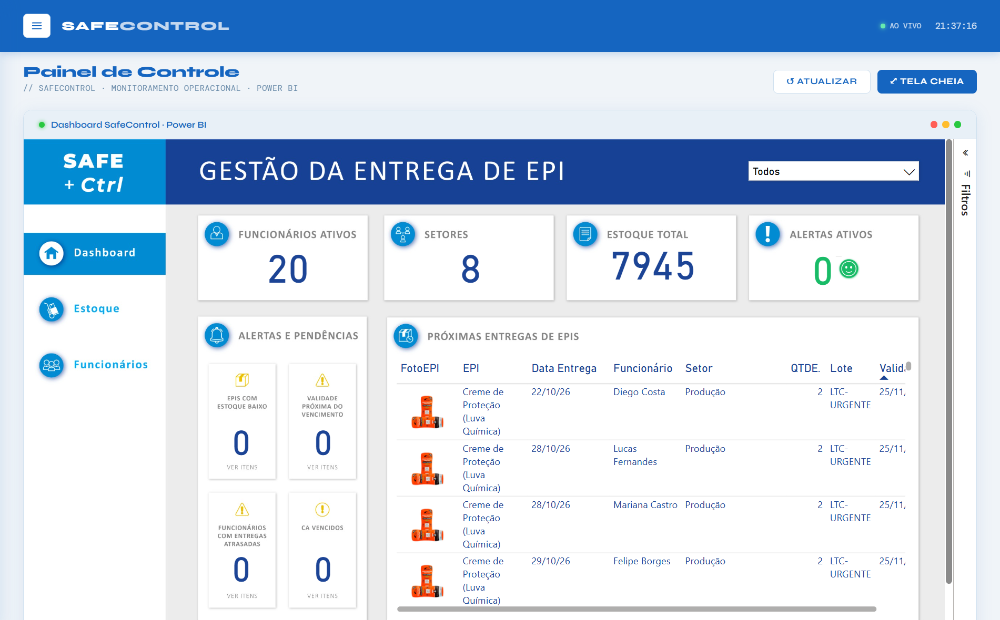
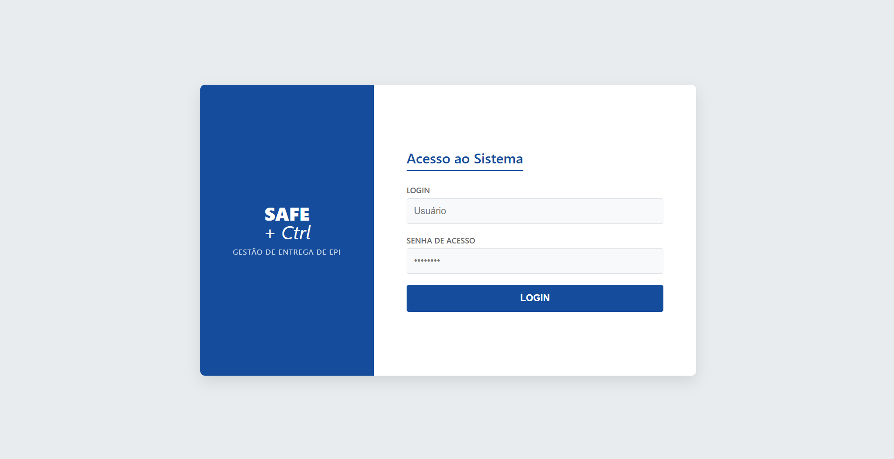
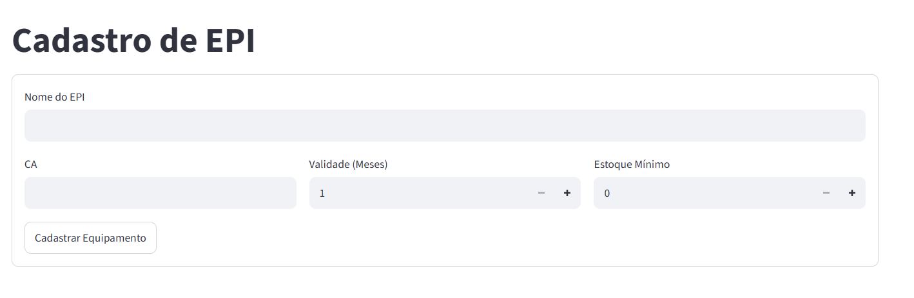
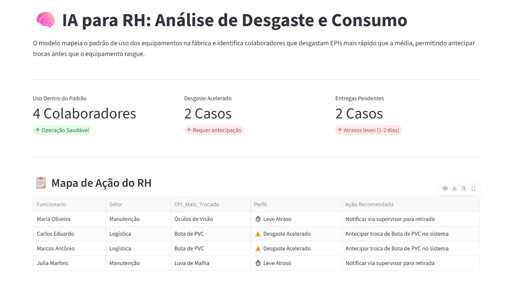

# SafeControl

Plataforma de gestão e controle de entrega de Equipamentos de Proteção Individual (EPIs), desenvolvida para eliminar o uso de fichas de papel e reduzir perdas de documentos no acompanhamento de segurança do trabalho.



## Contexto

O projeto nasceu de uma demanda real da empresa Uau Inglesa, apresentada durante a graduação no SENAI. O controle de entrega e devolução de EPIs na operação era feito de forma manual em papel, o que gerava extravio de documentos, dificuldade para rastrear prazos de validade e falta de visibilidade sobre o consumo de equipamentos por setor.

Assumi o desenvolvimento integral do protótipo funcional, desde a modelagem do banco de dados até a criação dos painéis analíticos, da interface de cadastro e da lógica de agrupamento para análise de desgaste.

## Como a arquitetura funciona

O sistema foi dividido em duas frentes conectadas ao mesmo banco de dados no SQL Server:

1. **Camada gerencial (HTML + Power BI):** Responsável pela autenticação inicial e pela exibição do painel de indicadores em modo gestão à vista, com suporte a tela cheia.
2. **Camada operacional e analítica (Python + Streamlit):** Acessada pelo menu lateral, concentra o registro de movimentações em tempo real, a emissão de documentos e o modelo de agrupamento de desgaste.

## O que a plataforma faz

- **Autenticação e gestão à vista:** Após o login, a tela inicial exibe um dashboard do Power BI incorporado em HTML, com opção de modo em tela cheia para acompanhamento contínuo dos indicadores da operação.
- **Cadastro em tempo real:** Por meio de um menu lateral, o usuário acessa a aplicação em Streamlit para registrar novas entregas de EPIs e movimentações diretamente no banco de dados.
- **Exportação de relatórios:** Permite consultar o histórico de entregas no banco e gerar relatórios em PDF e CSV para auditoria e controle interno.
- **Análise de desgaste antecipado:** Utiliza o algoritmo K-Means para agrupar padrões de uso e troca, identificando setores ou perfis com desgaste prematuro de equipamentos.

## Telas do sistema

**Tela de login e navegação**


**Operação e cadastro em tempo real (Streamlit)**

[Interface de cadastro de entrega de Entregas](assets/cadastro_entregas.png)

**Análise de desgaste antecipado (K-Means) e exportação de relatórios**


## Tecnologias utilizadas

- **SQL Server:** Banco de dados relacional escolhido para estruturar o histórico de colaboradores, entregas e vencimentos com integridade.
- **HTML:** Utilizado na estrutura de autenticação e na incorporação do painel gerencial para visualização direta no navegador.
- **Power BI:** Responsável pelos indicadores visuais da tela inicial, facilitando a leitura gerencial e a gestão à vista.
- **Python e Streamlit:** Usados para construir a interface operacional de cadastros, consultas ao banco e exportação de documentos.
- **Scikit-Learn (K-Means):** Aplicado na segmentação dos dados de entrega para detectar padrões de desgaste antecipado dos EPIs.

## Decisões e desafios técnicos

A separação entre Power BI e Streamlit foi definida para atender a dois momentos distintos da rotina operacional. O Power BI ficou concentrado na tela inicial para oferecer uma visão rápida e consolidada de indicadores sem exigir interação complexa. Já o Streamlit foi escolhido para a área operacional por permitir escrever e ler dados no SQL Server em tempo real, além de gerar arquivos PDF e CSV diretamente a partir de consultas em Python.

Um dos principais pontos de atenção na integração foi garantir a consistência das datas e dos tipos de dados trafegados entre o SQL Server e o Python, tanto para evitar falhas na geração dos relatórios em PDF quanto para preparar a base numérica que alimenta o K-Means. Para a etapa de inteligência artificial, optei pelo K-Means por ser um algoritmo não supervisionado adequado para agrupar ocorrências semelhantes de troca de EPIs sem depender de uma base histórica previamente rotulada com falhas.

## Como rodar

1. Clone o repositório e acesse a pasta do projeto:

```bash
git clone <url-do-repositorio>
cd <nome-da-pasta>
